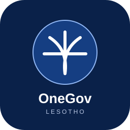
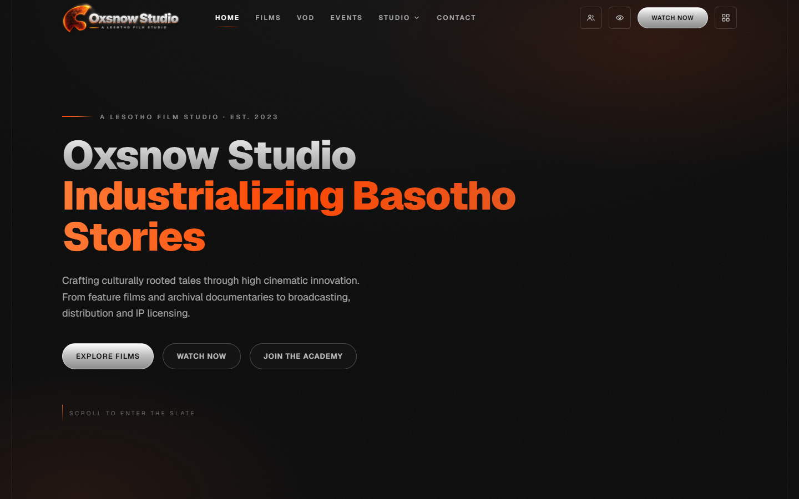
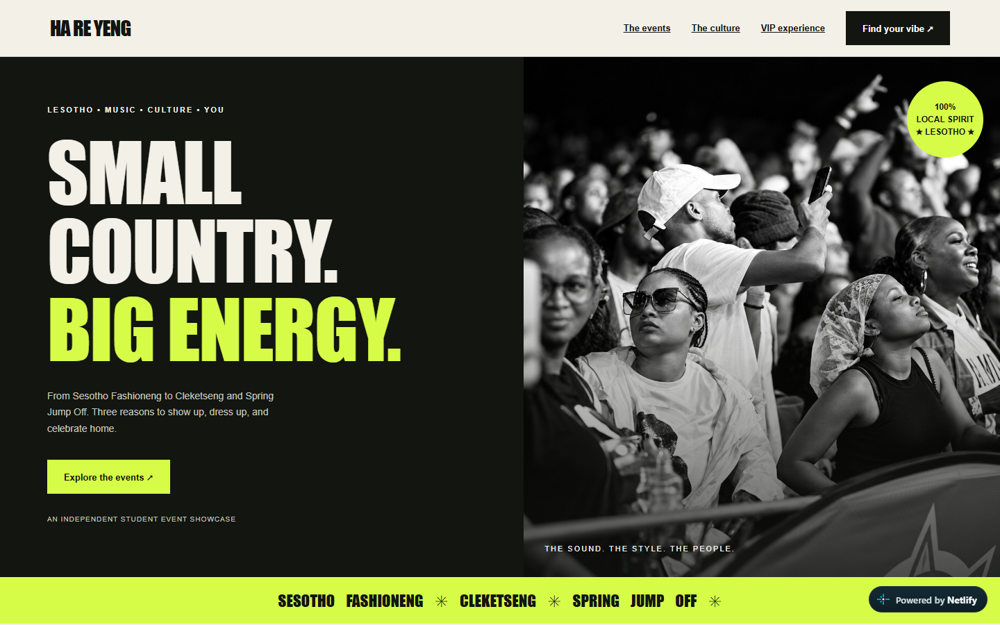

I'm **Keletso Hato**, a software engineering student at Limkokwing University of Creative Technology in Lesotho, and a self-taught developer learning by building. I work across desktop apps, web experiences and creative technology, turning ideas into practical projects and improving with each release.

**[Explore my portfolio ↗](https://hato-portfolio.vercel.app/)** &nbsp; · &nbsp; **[Connect on GitHub ↗](https://github.com/Hato444)**

---

## 01 / Software I've Built

Select an icon to explore the project. Each product keeps its own identity.

  &nbsp;
  &nbsp;
  &nbsp;
  &nbsp;
  

- **[TENKONVERTA](https://github.com/Hato444/TENKONVERTA)** — Electron desktop video downloader using yt-dlp and FFmpeg; adapted from [ArcDLP](https://github.com/archisvaze/arcdlp).
- **[DLALA](https://github.com/Hato444/-DLALA)** — JavaFX music and video player developed for university coursework.
- **[Oxsnow Studio](https://oxsnow.vercel.app/)** — a web presence for Basotho film and storytelling. [Source ↗](https://github.com/Hato444/oxsnow)
- **[HA RE YENG](https://bejewelled-beignet-e43cfc.netlify.app/)** — an independent student showcase for Lesotho events and culture.
- **[OneGov Lesotho](https://github.com/Hato444/-onegov-lesotho)** — a collaborative civic-services prototype exploring a unified citizen record; not an official government service.

### Inside the work

Oxsnow Studio — website homepage

HA RE YENG — events showcase homepage

---

## 02 / The toolkit

Technologies I've used in projects and coursework; always learning.

**Web** · HTML, CSS, JavaScript, React, Next.js 

**Application &amp; backend** · Java, JavaFX, Electron, Node.js, Express, Python 

**Tools** · Git, GitHub, VS Code, Figma 

---

## 03 / Engineering notes

Topics I want to write about as I document the work:

- Building and customizing TENKONVERTA
- Developing DLALA with JavaFX
- OneGov Lesotho's service architecture
- Lessons from deploying Oxsnow Studio
- Software testing, licensing, security and deployment

These are future write-up topics, not published articles.

## 04 / Activity

## 05 / Support my work

If you enjoy the projects, exploring the repositories, sharing feedback, or collaborating is a great way to support the work.

---

**Let's build something useful.** [Portfolio](https://hato-portfolio.vercel.app/) · [GitHub](https://github.com/Hato444)
